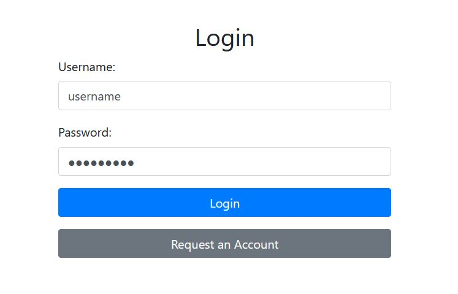
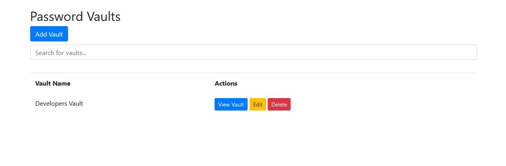
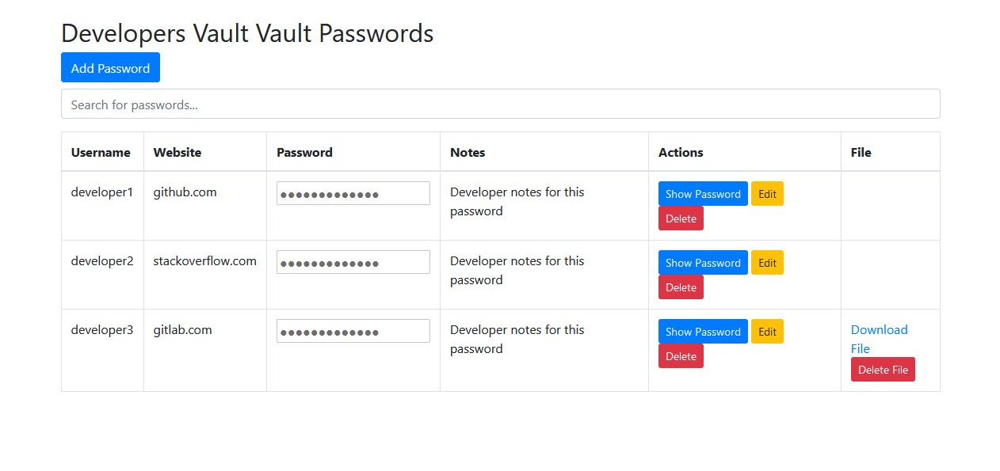
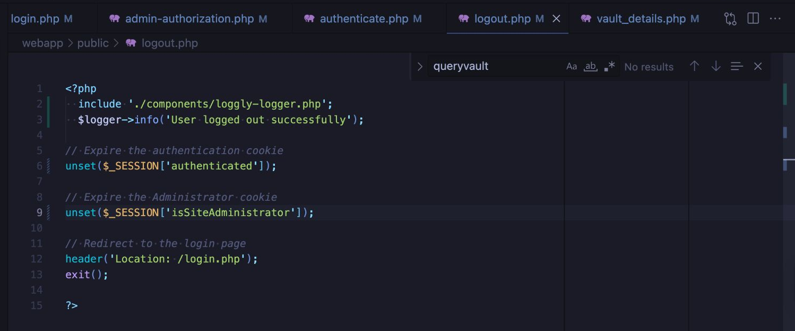
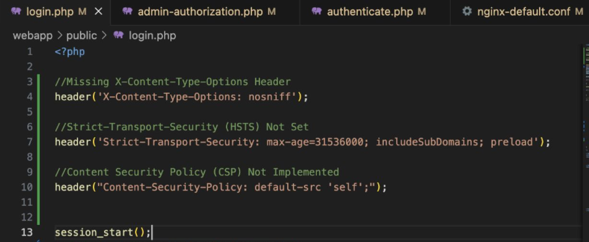

# Huskey Password Manager

I started with a password manager web app that worked but had almost no security, then found the problems and fixed them.

## How the app is set up

It runs in Docker with three containers:

- Nginx serves the static files and acts as a reverse proxy
- PHP handles the app logic, logins, and database calls
- MySQL stores users, vaults, and passwords

```
Browser --HTTPS--> Nginx --> PHP --> MySQL
                              |
                              +--> Loggly (security logs)
```

 



## What was wrong with it

When I started:

- Everyone shared one login (username / password!)
- Traffic went over plain HTTP, so passwords could be sniffed
- Nothing was logged
- There was no real access control
- The login and forms were open to SQL injection and XSS
- Stored credentials weren't encrypted
- The app decided who you were based on cookies, which you can edit in the browser. Setting `isSiteAdministrator=1` made you an admin.

More detail on each one is in [docs/SECURITY_FINDINGS.md](docs/SECURITY_FINDINGS.md).

## What I changed

### HTTPS
I used OpenSSL to make a private key and a certificate signing request, got the certificate signed by a private root CA, and set up Nginx to serve everything over HTTPS on port 443.

### Sessions instead of cookies
This was the biggest fix. The app used to store the logged-in user and the admin flag in cookies, so anyone could change them. I moved both into PHP sessions so they live on the server and the browser only gets a session ID.

```php
// before
setcookie('authenticated', $username);

// after
$_SESSION['authenticated'] = $username;
```



### Roles
I added basic role-based access control:

- Admin: full access
- Regular user: only their own vaults
- Vault owner: manages a vault
- Editor / viewer: can edit or only view inside a vault

### SQL injection and XSS
I started treating all user input as untrusted and validated the login and form fields. I also added three headers at the top of login.php:

- `Strict-Transport-Security` so browsers only use HTTPS
- `Content-Security-Policy: default-src 'self'` so the page only loads content from the same site, which stops most XSS
- `X-Content-Type-Options: nosniff` to stop MIME sniffing



### Logging
I added a logging component using Monolog (a PHP logging library) that sends events to Loggly. The Loggly token is in a .env file instead of the code. It logs:

- Failed logins, to catch brute-force attempts
- Vaults being created or deleted, so there's a record of changes to sensitive data
- Logouts

The logger setup is in [code-samples/loggly-logger.php](code-samples/loggly-logger.php).

### Testing
I wrote Pytest scripts that send SQL injection and XSS payloads to the app and check that they don't work, plus a check that the site responds over HTTPS. I also used Selenium to make sure a normal login still works and a bad one fails.

## What I'd do next

- Move the database password out of login.php and into the .env file like I did with the Loggly token
- Set HttpOnly, Secure, and SameSite on the session cookie, regenerate the session ID after login, and destroy the session completely on logout
- Set up alerts in Loggly for things like repeated failed logins
- Run OWASP ZAP scans again after big changes

## Files

- `code-samples/` has the logger, logout, and security header code
- `docs/SECURITY_FINDINGS.md` goes through each vulnerability
- `docs/screenshots/` has the screenshots

This repo is a write-up of the security work, with the key code and screenshots.
